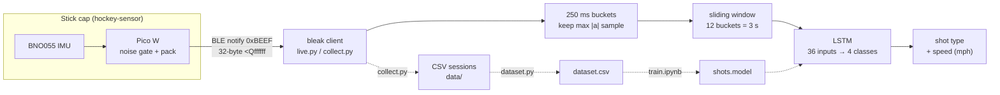
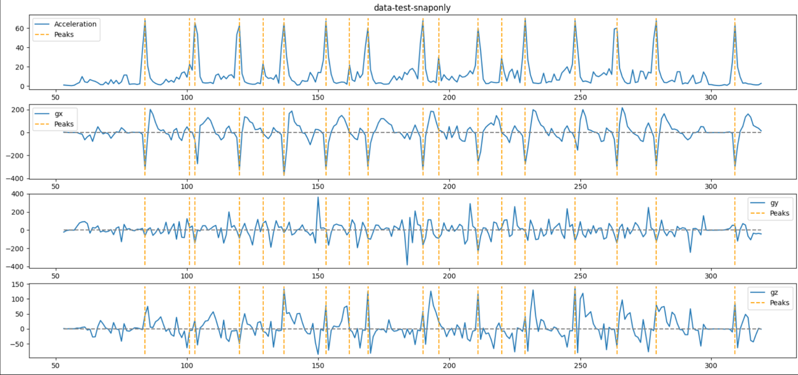
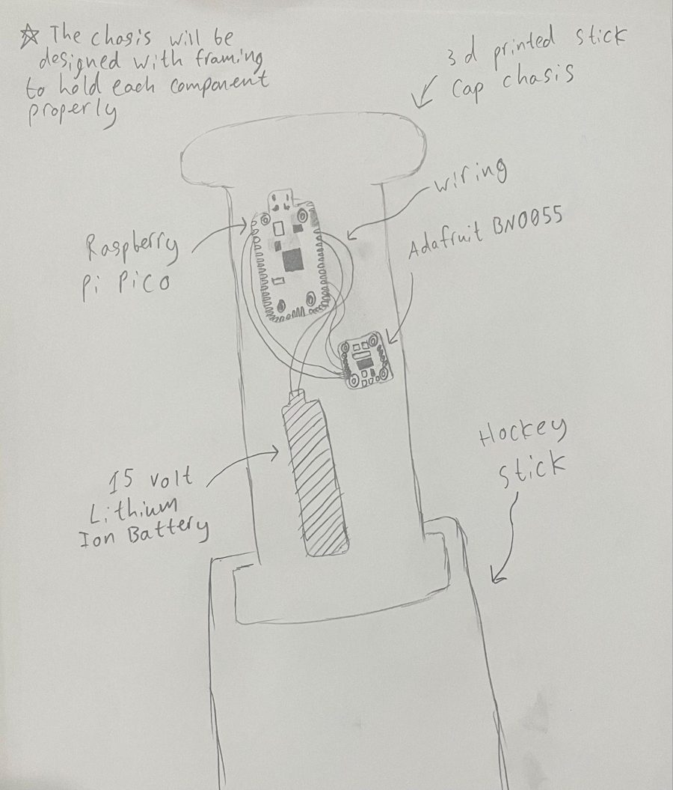

# hockey-sensor-client

Real-time hockey shot detection from a sensor in the stick. A Raspberry Pi Pico W and a BNO055 IMU inside the stick's end cap stream gyroscope and linear-acceleration samples over Bluetooth LE. This repository holds the laptop side. It receives that stream, compresses it into a fixed-size view of the last three seconds of motion, and runs a small LSTM that decides whether a shot just happened and whether it was a wrist, snap or slap shot. It also estimates the shot's speed from the peak acceleration. The repo also contains the recorded sessions, the training pipeline, the analysis notebooks and the research paper behind the project.

| Repository | Role |
| --- | --- |
| [hockey-sensor](https://github.com/Alexirlixer/hockey-sensor) | Firmware on the stick: IMU sampling, on-device noise gate, binary packing, BLE peripheral |
| **hockey-sensor-client** (this repo) | Laptop side: BLE client, data collection, shot detection and classification, speed estimate, training |

A write-up of the whole project is on the portfolio site: [alexirlixer.github.io](https://alexirlixer.github.io/#hockey). The full research write-up is [`paper.pdf`](paper.pdf), by Alex Apostolescu and Erik Kittelson (Engineering Senior Research, Academy of Engineering and Technology).

## How it works



1. **Connect.** `live.py` (and `collect.py`) use [bleak](https://github.com/hbldh/bleak) to scan for a device advertising service `0xBEEF`. It then connects and subscribes to notifications. If the sensor disconnects, the script waits 10 s and scans again.
2. **Decode.** Each notification holds one sample, which is decoded with `struct.unpack("<Qffffff", data)`: a microsecond timestamp, gyro x/y/z and linear acceleration x/y/z. The format is described under [BLE wire format](#ble-wire-format).
3. **Bucket.** `shot_detect` in `detect.py` converts the timestamp to milliseconds and adds a ninth column holding the acceleration magnitude `|a|`. It collects samples into a 250 ms bucket. A bucket closes when a sample arrives 250 ms or more after the bucket's first sample, or when it holds 250 samples. The bucket is then reduced to a single row: the sample with the largest `|a|`.
4. **Window.** Those one-per-bucket rows go into a 12-slot ring buffer (`buffer.py`), which holds three seconds of motion. Once the buffer is full, every new bucket produces a window covering the latest 12 buckets.
5. **Classify.** The x, y and z acceleration of the 12 rows are flattened into 36 numbers and fed to the LSTM, which predicts one of `0` no shot, `1` wrist, `2` snap or `3` slap.
6. **Report.** If the prediction is a shot, and the peak in this window is not the same peak already reported, the shot counter goes up. The script then prints one line per shot:
   ```
   [<count>] [at:<peak timestamp, ms>] [acc: <peak |a|, m/s²>] [mph: <speed estimate>] [<wrist|snap|slap>]
   ```

## BLE wire format

This is the contract with the [hockey-sensor](https://github.com/Alexirlixer/hockey-sensor) firmware.

| Item | Value |
| --- | --- |
| Advertised name | `hockey-sensor` |
| Service UUID | `0000beef-0000-1000-8000-00805f9b34fb` (16-bit `0xBEEF`) |
| Measurement characteristic | `0000beef-0000-1000-8000-00805f9b34fb`, notify, one sample per notification |
| Battery characteristic | `0000b00f-0000-1000-8000-00805f9b34fb`, notify once per second, `<f` volts (not used by this client yet) |

The service and the measurement characteristic share a UUID. That is why `start_notify(SENSOR_SERVICE_UUID, ...)` subscribes to the right characteristic.

Measurement payload: `<Qffffff`, 32 bytes, little-endian.

| Offset | Size | Type | Field | Unit |
| ---: | ---: | --- | --- | --- |
| 0 | 8 | `uint64` | timestamp (`time.ticks_us()` on the Pico) | µs |
| 8 | 12 | 3 × `float32` | gyro x, y, z | deg/s |
| 20 | 12 | 3 × `float32` | linear acceleration x, y, z (gravity removed) | m/s² |

The firmware only sends samples whose linear-acceleration magnitude is above 0.20 m/s², so the stream contains motion only and has no fixed rate. In the recorded sessions the median gap between samples is 4 to 7 ms. `collect.py` writes each decoded sample as one CSV row in the same order: `ts, gx, gy, gz, ax, ay, az`.

## Engineering highlights

### Turning a variable-rate stream into fixed model input

An LSTM needs input of a fixed shape, but the sensor stream has no fixed rate. The firmware drops quiet samples, and the BLE link delivers notifications in bursts. Max-pooling into 250 ms buckets turns this stream into a regular series of four rows per second, and the pooling uses the Pico's own timestamps, so BLE delivery jitter does not affect it. Keeping the **maximum**-magnitude sample, not the mean, matters here. A shot is a short spike lasting tens of milliseconds, and averaging it with 250 ms of follow-through would flatten it. Twelve buckets with three axes each give the 36-value input. Because the firmware never sends quiet stretches, no empty buckets are produced: a window is 12 consecutive buckets of *motion*, and idle time between shots is skipped, not padded with zeros.

### Sliding window with peak de-duplication

A new window is classified after every bucket, so a single shot passes through up to 12 consecutive windows. `shot_detect` records the device timestamp of the peak in each window it reports as a shot. It ignores later windows whose peak is that same sample, so one shot is counted once even though it is seen many times.

### One pipeline for live, replay and training

`live.py` and `offline.py` both send samples into the same `shot_detect.on_measurement()`. One receives them from BLE notifications, the other from a CSV file. Replaying a recorded session therefore runs exactly the code a live session runs, with no hardware, as fast as the CPU allows (`offline.py` prints the elapsed time). The training set was built with the same bucket-max and window logic, so the model sees the same input at training time as at inference time.

### From peak detection to a classifier

The first approach was signal processing. `short-speed.ipynb` groups samples into the same 250 ms bucket maxima and runs `scipy.signal.find_peaks` with a 20 m/s² height threshold:



*Peak detection on `data-test-snaponly.csv`, top panel acceleration magnitude (m/s²), lower panels gyro x/y/z (deg/s); figure 4 in the paper.*

This picks out the shots clearly, but it also flags the smaller 20 to 30 m/s² peaks between shots. A threshold also cannot say *which* shot was taken. The paper describes replacing peak detection with an LSTM that does both jobs in one pass. The "no shot" class handles detection, and the other three classes handle classification.

### Labels from session structure and physics

`dataset.py` labels the data with no manual annotation:

- Each recording session contains a single shot type, so the file name supplies the class (`radar-snap` is snap, `100-wrist` is wrist, `move` and `static` are no shot, and so on).
- A window counts as a shot only if its peak bucket converts to more than 50 mph with the speed formula below, which works out to about 57.6 m/s². Windows whose peak is weaker become **no-shot** examples, even when they come from a shot session. This is how the model learns to ignore stickhandling: `test-snaphandle` mixes snap shots with stickhandling between them.
- A shot is labeled once, at the first window where its peak has moved back to bucket 8 or earlier (buckets are numbered 0 to 11, oldest first). Windows where the peak is still in the newest three buckets are skipped. As a result, almost every positive example has the spike at bucket 8, about three-quarters of a second before the end of the window, so the shot sits in a consistent position.

The paper also describes enlarging the dataset by shifting values while preserving the shape of each shot. In `train.ipynb` this is done by multiplying the whole dataset by 10 random factors drawn from [-10, 10], so it grows to 11 times its original size.

### The model

`shot_classifier` is a 2-layer `nn.LSTM` (36 inputs, 64 hidden units) followed by a `Linear(64, 4)`. That is 59,652 parameters, and the saved `shots.model` is 242 KB. It is trained for 10 epochs with Adam (lr 1e-3), cross-entropy loss and batch size 10. It is small enough to run once per bucket on a laptop CPU with no noticeable delay. Each window enters the network as one flattened 36-value step, so the timing of the shot is captured by the order of the features rather than by the LSTM's time axis.

### Speed from acceleration alone

`mph()` estimates puck speed from the peak bucket with a kinetic-energy-transfer model:

```
v_stick = a_peak × 0.25 s                       # peak acceleration held over one bucket
v_puck  = sqrt(0.385 × v_stick² / 0.160)        # ½·m₁·v₁² = ½·m₂·v₂²
mph     = v_puck × 2.2369
```

The code does not document the constants 0.385 and 0.160. They are consistent with a stick mass and a puck mass in kilograms. A peak of 68 m/s² gives about 59 mph. This is a first-order estimate that needs no radar gun. `data/data-radar-shots.txt` holds radar-gun readings for the two radar sessions (15 wrist shots at 29 to 61 mph, 15 snap shots at 44 to 64 mph), but the repo does not yet compare them with the estimates.

### Hardware that doesn't change the stick



*Design sketch of the stick cap (figure 1 in the paper).*

The electronics sit in a 3D-printed cap made of TPU, a light, flexible filament. It replaces the stick's normal end cap. The cap is longer than a stock one so it can hold the parts, but the extra length goes inside the shaft, so the stick's playing length does not change and it could still be used in a game. A lithium-ion battery powers the system.

## Research context

**Problem.** Shot tracking in hockey usually relies on external speed radars, placed in the goal or around the rink. Other players moving nearby interfere with their readings, and they only report speed, so they tell a player nothing about technique. Studies using inertial sensors to analyze golf and tennis swings suggested that a low-cost IMU on the stick could capture a hockey shot as well.

**Approach.** Build the stick-cap sensor, record shooting sessions of one shot type each (wrist, snap, slap), and train an LSTM to detect and classify shots in real time. The success criterion set in the paper was a model accuracy above 90%. All sessions were recorded on a training surface, not on ice.

**Results.** Data collection worked as planned, and the filtered acceleration traces showed one clear peak per shot (figure 2 in the paper). Peak detection found the shots, and the trained LSTM, run over a sliding window, detected and classified them in real time. The paper does not report an accuracy figure. `train.ipynb` reports 99.3% on 3,360 held-out windows. However, the augmentation runs before the random 80/20 split, so scaled copies of training windows also appear in the test set, and that number overstates real-world accuracy. The training set is also imbalanced: 1,358 no-shot, 130 wrist, 37 snap and 2 slap windows.

**Applications.** The same capture-and-compare idea applies to other swing sports (golf, tennis, lacrosse, field hockey). It could also apply to work that depends on precise movement, such as monitoring physical-therapy exercises, fall detection and surgical training.

## Running it

### Requirements

Python 3.10 or later (`detect.py` uses `match`) and a Bluetooth LE adapter. Packages, taken from the imports:

```sh
pip install bleak numpy pandas torch                      # live.py, collect.py, offline.py, dataset.py
pip install jupyter matplotlib seaborn scipy plotly       # notebooks
```

Run the scripts from the repository root, because `detect.py` loads `shots.model` from the current directory. The sensor must be running the [hockey-sensor](https://github.com/Alexirlixer/hockey-sensor) firmware.

### Live detection

```sh
python live.py
```

Power on the stick. The script finds `hockey-sensor`, connects, and prints a line for each shot it detects. It reconnects automatically if the link drops.

### Recording a session

```sh
python collect.py
```

This logs every sample to `data.csv` and prints it to the console. The file is reopened (and overwritten) each time the script connects, so rename it after each session, for example `mv data.csv data/data-my-session.csv`.

### Replaying a recording offline

```sh
python offline.py
```

This replays `data/data-test-snaphandle.csv` through the live pipeline, then prints each detected shot and the total time taken. To replay a different session, change the `dataset` variable at the bottom of `offline.py`.

### Retraining

1. Add a session to the `datasets` dictionary in `dataset.py`, mapping its name to a label (`0` no shot, `1` wrist, `2` snap, `3` slap).
2. Run `python dataset.py` to rebuild `dataset.csv`.
3. Run all cells in `train.ipynb`. The last cell writes `shots.model`, which `detect.py` loads.

The bundled `dataset.csv` and `shots.model` already match each other, so you only need these steps if you change the data. As the repo stands, `dataset.py` will not run without two fixes:

- It imports `measurements`, a module removed in commit `d3de930`. Restore it with `git show dd67782:measurements.py > measurements.py`.
- It lists a `test` session, but `data/data-test.csv` is not in the repo.

## Repository layout

| Path | Purpose |
| --- | --- |
| `live.py` | BLE client and real-time shot detection |
| `collect.py` | BLE client that records samples to `data.csv` |
| `offline.py` | Replays a recorded CSV through `shot_detect` |
| `detect.py` | `shot_detect` (bucketing, windowing, de-duplication), `shot_classifier` (the LSTM), `mph()` |
| `buffer.py` | `fixed_size_buffer`, a NumPy ring buffer holding the 12-bucket window |
| `dataset.py` | Builds labeled windows from `data/` into `dataset.csv` |
| `dataset.csv` | 1,527 labeled windows (36 features and a label) |
| `train.ipynb` | Augmentation, train/test split, training and evaluation; writes `shots.model` |
| `shots.model` | Trained LSTM weights (PyTorch `state_dict`) |
| `short-speed.ipynb` | Bucket-max peak detection and per-shot speed estimates |
| `acceleration-analysis.ipynb`, `gyro-analysis.ipynb`, `analyze-raw-noise.ipynb` | Exploratory plots: acceleration magnitude, 3D gyro trajectory, static-vs-moving noise distributions |
| `data/` | Recorded sessions (see below) |
| `docs/` | Figures used in this README |
| `paper.pdf` | Research paper |

Some of the exploratory notebooks read their CSV from the repository root (`./data-*.csv`). Point them at `data/` to run them.

### Recorded sessions

| File | Label in `dataset.py` | Length |
| --- | --- | ---: |
| `data-100-wrist.csv` | wrist | 500 s |
| `data-radar-wrist.csv` | wrist (radar readings in `data-radar-shots.txt`) | 126 s |
| `data-test-wrist.csv` | wrist | 34 s |
| `data-radar-snap.csv` | snap (radar readings in `data-radar-shots.txt`) | 114 s |
| `data-test-snaponly.csv` | snap | 67 s |
| `data-test-snaphandle.csv` | snap, with stickhandling between shots | 56 s |
| `data-test-slaponly.csv` | slap | 12 s |
| `data-move.csv` | no shot (general movement) | 64 s |
| `data-static.csv` | no shot (stick at rest, almost entirely below the 0.20 m/s² gate) | 65 s |
| `data-stick.csv` | not used by `dataset.py` | 201 s |

## Limitations

- **Accuracy is unproven.** The 99.3% test figure is inflated by augmentation leakage, there are only 2 slap-shot windows, and all data comes from a training surface. A proper estimate would split by session before augmenting.
- **Batching in training.** `train.ipynb` passes 2-D `(batch, 36)` tensors to an `nn.LSTM` with `batch_first=True`. PyTorch reads a 2-D input as one unbatched sequence, so during training and evaluation each batch of 10 shuffled windows is treated as a 10-step sequence. At inference in `detect.py` there is a single step per call.
- **The speed estimate is a model, not a measurement.** It has not been calibrated against the radar readings in `data/`.
- **The battery characteristic is not used.** Battery voltage is broadcast by the firmware but this client does not subscribe to it.
